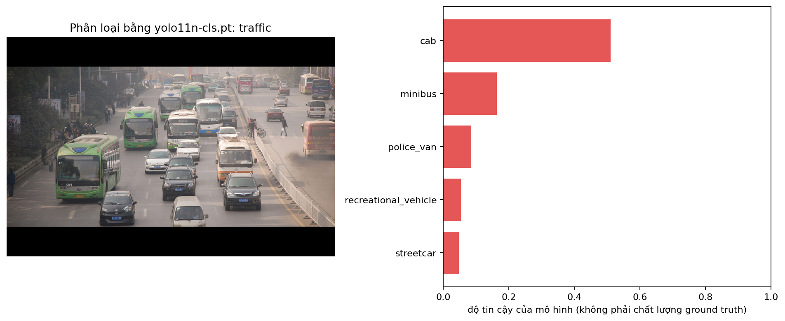
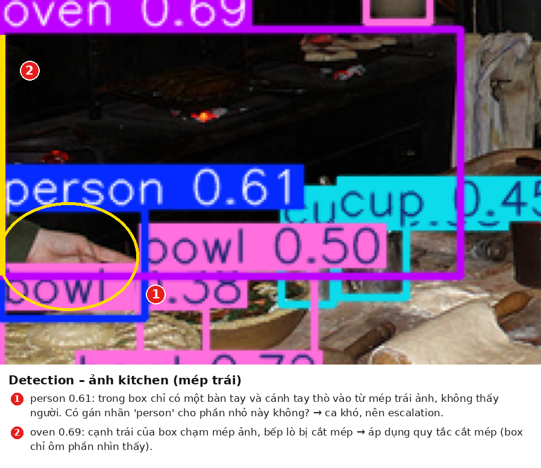
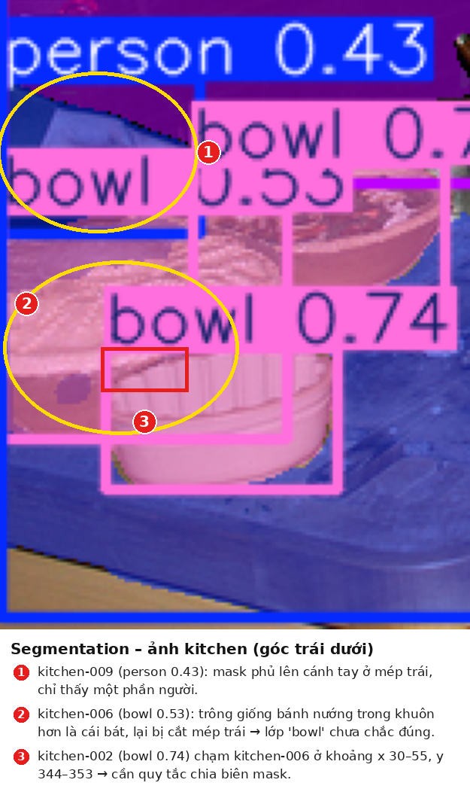
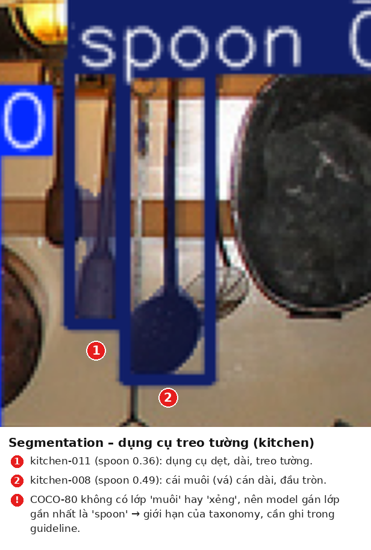

# Báo cáo bài thực hành Ngày 1 – Đọc prediction YOLO11 để hiểu định dạng nhãn

**Ngày chạy:**06/11/2026

**Runtime Colab:** GPU

**Python / PyTorch / Ultralytics:** Ultralytics 8.4.145

**Checkpoint:** `yolo11n-cls.pt`, `yolo11n.pt`, `yolo11n-seg.pt`

**Ngưỡng detection/segmentation dùng khi tạo JSON:** `0.35` (chỉ đổi nếu GV cho phép; nếu đổi hãy ghi rõ)

**Thay đổi so với notebook nguồn:** Không / mô tả rõ thay đổi

> **Cách dùng mẫu này:** copy/điền trên máy, lưu thành `REPORT.md`, rồi **upload** vào panel Files
> của Colab (notebook không tự tạo file này). Ô cuối Colab sẽ đóng ZIP cùng `day1_lab_outputs/`.
> Giải nén và đưa vào `report/` trên GitHub, rồi nộp **link repo** trên LMS.
> Không ghi họ tên, MSSV, email, số điện thoại hoặc dữ liệu cá nhân khác vào báo cáo/output;
> họ tên/MSSV chỉ nằm trong tên repository.

### Từ cần nhớ (đọc nhanh trước khi viết)

| Từ | Nghĩa ngắn |
| --- | --- |
| Prediction | Kết quả model vừa đoán ra; chưa phải nhãn đúng |
| Ground truth | Nhãn do người gán theo quy tắc |
| Taxonomy | Danh sách tên lớp có sẵn kèm model (vd. ImageNet-1K, COCO-80) |
| Checkpoint | File model `.pt` đã huấn luyện sẵn |
| Guideline | Quy tắc gán nhãn do người viết |
| Annotator | Người gán nhãn |
| Reviewer / QC | Người kiểm tra nhãn |
| Escalation | Ca khó → hỏi Lab Coach, không tự bịa |
| Model score | Số “tin” của model; không phải điểm chất lượng nhãn người |

## 1. Phân loại ảnh

**Mở file:** `day1_lab_outputs/classification_predictions.json` và `visuals/classification_top5.png`.  
Chỉ dùng ảnh `sample_id = traffic`, lấy dòng `rank = 1`.

1. Chép record hạng 1: `class_id`=468 ; `class_name`=cab ; `rank`=1 ; `score`=0.510915 ; `taxonomy_name`=ImageNet-1K
2. Record này nói về **cả bức ảnh** hay về **một vật thể riêng** trong ảnh? Vì sao bạn nghĩ vậy? Trong record không có tọa độ nào, nó không chỉ ra vật thể nằm ở đâu vì vậy record này nói về **cả bức ảnh**
3. Danh sách tên lớp (class list) do đâu mà có: model tự nghĩ ra, hay đi kèm taxonomy/checkpoint? Danh sách này đi kèm taxonomy/checkpoint, model không tự nghĩ ra.
4. Vì sao cần ghi cả `class_id`, `class_name` và `taxonomy_name`, không chỉ ghi mỗi tên lớp? Thứ nhất là vì chỉ ghi 'class_name' thì khá mơ hồ. 'class_name' có thể trùng nhau nay trong một taxonomy ví dụ như trong ImageNet-1K 'class_name'=crane có thể là con sếu hoặc cần cẩu, do đó cần 'class_id' để phân biệt 2 lớp này. Thứ 2 là cùng một id có nghĩa khác nhau ở các taxonomy khác nhau. Trong file segmentation (COCO-80), class_id=2 là car; nhưng trong ImageNet-1K, id 2 là một loài cá mập (great white shark). Ngoài ra, id 468 (“cab”) của ImageNet không hề tồn tại trong COCO-80, vì COCO chỉ có 80 lớp (id 0–79). Vì vậy phải ghi taxonomy_name để biết id được tra trong danh sách nào. Và cuối cùng là để người khác kiểm tra lại và tái lập được kết quả.
5. Nếu trong ảnh có nhiều vật / nhiều chủ đề, guideline cần nói rõ điều gì để người gán nhãn chọn **một** lớp? Guideline cần quy định rõ: (1) chọn chủ thể chiếm diện tích lớn nhất hoặc ở trung tâm ảnh; (2) nếu hai chủ thể ngang nhau thì chọn chủ thể ở gần trung tâm hơn; (3) chọn lớp cụ thể nhất có trong taxonomy; (4) nếu không có lớp phù hợp thì gắn cờ để review, không đoán. Ví dụ với ảnh traffic có nhiều bus và car, guideline phải nói rõ chọn loại xe nào.
6. Vì sao không được lấy `score` của model làm ground truth? Model score là độ tự tin của model, không phải sự thật. Model hoàn toàn có thể sai mà vẫn tự tin. Riêng record của tôi, 0.51 nghĩa là model chỉ khoảng “nửa chắc nửa không”. Nếu lấy dự đoán của model làm đáp án, ta sẽ không thể đánh giá được model. Đem model so với chính nó thì lúc nào cũng đúng 100%, tức là lập luận vòng tròn. Lỗi và thiên lệch của model sẽ bị đưa thẳng vào dữ liệu, rồi được dùng để huấn luyện tiếp. Ground truth phải do con người gán theo guideline, sau đó mới dùng nó để đo xem model đúng hay sai.

## 2. Phát hiện vật thể

**Mở file:** `day1_lab_outputs/detection_predictions.json` và `visuals/detection_predictions.png`.  
Chỉ dùng ảnh `sample_id = kitchen`. Chọn **một** record.  
Số lượng prediction theo ngưỡng: xem output ô so sánh `0.20` / `0.35` / `0.60` trong notebook.

1. Chép một record: `class_name`=bowl ; `score`=0.701283 ; `bbox_xyxy`=[155.02,
      168.67,
      182.38,
      184.18] ; `bbox_width`=27.36 ; `bbox_height`=15.51
2. Giải thích box bằng lời thường: góc trên-trái ở đâu, góc dưới-phải ở đâu, rộng/cao bao nhiêu pixel? 
Góc trên-trái ở vị trí (x1, y1) = (155.02, 168.67), góc dưới-phải ở vị trí (x2, y2) = (182.38, 184.18)
Tọa độ được tính từ góc trên-trái của bức ảnh, nơi có điểm (0, 0) x tăng dần khi đi sang phải, y tăng dần khi đi xuống dưới. Kích thước khung: Rộng = x2 − x1 = 182.38 − 155.02 = 27.36 pxl, cao = y2 − y1 = 184.18 − 168.67 = 15.51 px. 
3. Chọn hai ngưỡng (vd. 0.20 và 0.60). Mỗi ngưỡng có bao nhiêu prediction? 
Ngưỡng	Số prediction
0.20	17
0.60	6
4. Khi hạ ngưỡng (giữ nhiều hộp hơn), người **reviewer** phải làm thêm việc gì?
Khi hạ ngưỡng từ 0.60 xuống 0.20, reviewer phải kiểm tra thêm 11 box có score thấp. Với mỗi box, reviewer cần:
   - Xác nhận vật đó có thật trong ảnh hay không (ví dụ 3 box `spoon`, `bottle`, `potted plant` có đúng là có thật không), và xóa các box nhận nhầm.
   - Kiểm tra tên lớp có đúng không (ví dụ `cup` có bị nhầm với `bowl` không) và sửa nếu sai.
   - Phát hiện và xóa box trùng lặp, tức nhiều box cùng đè lên một vật (ví dụ kiểm tra 5 box `bowl` có ứng với đúng 5 cái bát khác nhau không).
   - Chỉnh lại box bị lệch hoặc không ôm sát vật.
   Đánh đổi: ngưỡng thấp giúp ít bỏ sót vật thật hơn nhưng tốn nhiều công review hơn; ngưỡng cao ít box sai hơn nhưng dễ bỏ sót các vật nhỏ như thìa, chai.
5. Viết **một quy tắc box** để người gán nhãn làm theo (áp dụng được cho nhiều ảnh, không chỉ ảnh này).
Vẽ box ôm sát phần nhìn thấy được của vật — các cạnh box chạm vào điểm ngoài cùng của vật ở cả bốn phía, không chừa khoảng trống thừa, không tính bóng đổ hay phản chiếu. Mỗi vật riêng biệt có đúng một box; nếu nhiều vật cùng loại đứng sát nhau (ví dụ chồng bát) thì vẫn vẽ box riêng cho từng vật nhìn phân biệt được.
6. Trên ảnh `kitchen`, chỉ ra **một** vật bị che khuất hoặc cắt mép. Bạn sẽ viết thành quy tắc trong guideline, hay đưa lên hỏi Lab Coach (escalation)? Vì sao? Trên ảnh `kitchen`, cái lò (oven, score 0.69) ở bên trái bị cắt ở mép trái ảnh: box bắt đầu sát mép trái, phần còn lại của lò nằm ngoài khung hình nên chỉ nhìn thấy được một phần.
Tôi chọn viết thành quy tắc trong guideline, vì:
- Vật bị cắt mép là tình huống rất phổ biến, sẽ lặp lại ở nhiều ảnh khác (bất kỳ vật nào nằm ở rìa ảnh), nên cần một luật chung thay vì hỏi lại từng lần.
- Trường hợp này không mơ hồ: dù bị cắt, vẫn nhận ra chắc chắn đó là cái lò, nên có thể xử lý thống nhất.
Quy tắc đề xuất: "Vật bị cắt mép ảnh vẫn được gán nhãn nếu nhận ra chắc chắn đó là vật gì. Box chỉ ôm phần nhìn thấy được trong ảnh và chạm vào mép ảnh ở phía bị cắt; không ước đoán phần nằm ngoài khung."
Chỉ đưa lên Lab Coach (escalation) khi phần nhìn thấy quá ít đến mức không xác định được là vật gì, vì khi đó mỗi người gán nhãn có thể đoán khác nhau và guideline hiện tại chưa đủ để quyết định.

## 3. Phân đoạn theo từng đối tượng

**Mở file:** `day1_lab_outputs/segmentation_predictions.json` và `visuals/segmentation_prediction.png`.  
Chỉ dùng ảnh `sample_id = kitchen`. Chọn **một** record.

1. Chép một record: `instance_id`=kitchen-011 ; `class_name`=spoon ; `score`=0.359147 ; số điểm polygon=`polygon_point_count`=37 ; 3–5 điểm đầu của `polygon_xy`=(529, 66), (529, 72), (528, 73), (528, 74), (527, 75)
2. So với box, polygon cho thêm thông tin gì về hình dạng vật thể?
Box chỉ cho biết vật nằm trong một hình chữ nhật (4 số), còn polygon là một chuỗi điểm (ở đây 37 điểm) đi vòng theo đường viền thật của vật, nên cho biết hình dạng chính xác.
   - Với cái thìa kitchen-011, box rộng khoảng 14 px và cao khoảng 71 px. Thìa là vật dài và mảnh, phần dưới loe ra, nên box chứa rất nhiều nền tường xung quanh không phải thìa.
   - Polygon thì đi sát theo cán thìa mảnh ở trên và phần đầu thìa rộng hơn ở dưới (các điểm có x từ khoảng 519 đến 531, y từ khoảng 88 đến 110). Nhờ vậy biết được đâu là thìa, đâu là nền, và tính được diện tích thật của vật.
   - Polygon cũng cho thấy các chỗ lõm, chỗ cong và phần bị che, mà box không thể hiện được.
3. `instance_id` dùng để làm gì? Nó **không** phải class ID và **không** phải tracking ID — bạn hiểu câu này thế nào?
`instance_id` dùng để phân biệt từng vật thể riêng lẻ trong cùng một ảnh. Ví dụ ảnh `kitchen` có 4 cái bát (kitchen-002, kitchen-003, kitchen-006, kitchen-010): cả 4 đều có cùng `class_id`=45 (bowl), nhưng mỗi cái có một `instance_id` riêng để biết đây là 4 cái bát khác nhau.
   - Nó không phải class ID: class ID cho biết vật thuộc loại gì (45 = bowl) và dùng chung cho mọi vật cùng loại; còn instance_id đánh dấu từng cá thể.
   - Nó không phải tracking ID: tracking ID dùng để theo dõi cùng một vật qua nhiều khung hình (ví dụ trong video). Còn instance_id chỉ có ý nghĩa trong một ảnh, một lần chạy model; kitchen-002 ở ảnh này hay ở lần chạy khác không có nghĩa là cùng một cái bát.
4. Viết **một quy tắc vẽ biên mask** để người gán nhãn làm theo.
Quy tắc vẽ biên mask: "Mask đi theo đúng mép ngoài nhìn thấy được của vật, sát đến từng pixel; không tính bóng đổ, phản chiếu hay nền lộ ra qua các khe hở của vật. Khi hai vật chạm hoặc chồng lên nhau, mỗi pixel chỉ thuộc về một vật: phần nhìn thấy thuộc về vật nằm phía trước, đường biên vẽ theo mép tiếp xúc nhìn thấy được, và không tô phần bị che khuất."
5. Trên ảnh `kitchen`, chỉ ra **một** chỗ biên mờ / hai vật chạm nhau / bị che. Bạn dùng guideline hay escalation? Vì sao?
Trên ảnh `kitchen`, ở góc trái phía dưới bàn có hai cái bát nằm sát nhau: kitchen-002 (bowl, score 0.74) và kitchen-006 (bowl, score 0.53). Polygon của hai bát này chạm vào nhau ở khoảng tọa độ x 30–55, y 344–353, nên khó xác định chỗ nào là biên của bát nào.
Tôi chọn dùng guideline, vì bát đĩa đặt sát nhau hoặc chồng lên nhau là tình huống rất thường gặp trong ảnh nhà bếp và bàn ăn, sẽ lặp lại ở nhiều ảnh, và có thể xử lý thống nhất bằng quy tắc ở câu 4 (mỗi pixel chỉ thuộc một vật, vật nằm trước được giữ phần nhìn thấy).
Chỉ khi biên mờ đến mức không nhìn ra được đó là hai vật hay một vật, hoặc không nhận ra đó là vật gì, thì mới escalation lên Lab Coach.

## 4. Vòng đời và kiểm tra chất lượng

Lab hôm nay chỉ **xem prediction**. Chuỗi dưới đây là vòng đời production để bạn nối các khái niệm:

`ảnh thô → guideline → ground truth → huấn luyện → prediction → QC/rework`

Điền bảng (viết ngắn, có dẫn chứng từ JSON/PNG khi nói về lỗi):

| Tác vụ | Ground truth trông như thế nào? (đơn vị nhãn) | Lỗi hoặc chỗ khó quyết định bạn thấy trên ảnh/JSON | Annotator làm gì? | Reviewer xem gì? |
| --- | --- | --- | --- | --- |
| Phân loại ảnh | **1 nhãn cho cả ảnh**: `class_id` + `class_name` + `taxonomy_name` (vd. 468 / cab / ImageNet-1K). Không có tọa độ, không có score. | Ảnh `traffic` có nhiều xe (file segmentation đếm được 8 bus, 12 car, 2 truck) nhưng top-1 chỉ là `cab` với score 0.51. Top-5 đều là phương tiện (minibus, police_van, recreational_vehicle, streetcar) → ảnh nhiều chủ thể, khó chọn một lớp; ImageNet không có lớp mô tả cả cảnh đường phố. (Hình 1) | Xem cả ảnh, chọn **một** lớp theo guideline (chủ thể chính, lớp cụ thể nhất có trong taxonomy). Không lấy top-1 của model làm đáp án. Không có lớp phù hợp → gắn cờ, escalation. | Nhãn có theo đúng guideline không; các annotator có chọn thống nhất cho ảnh nhiều chủ thể không; `class_id`, `class_name`, `taxonomy_name` có khớp nhau không. |
| Phát hiện vật thể | **1 box cho mỗi vật**: `class_name` + `bbox_xyxy` (pixel, gốc (0,0) ở góc trên-trái, x tăng sang phải, y tăng xuống dưới). Một ảnh có nhiều box, không có score. | Ảnh `kitchen`: ngưỡng 0.20 → 17 box, 0.35 → 11, 0.60 → 6. Các box chỉ xuất hiện khi hạ ngưỡng là vật nhỏ, score thấp (spoon ×3, bottle, potted plant, dining table). Box `person` 0.61 chỉ chứa một bàn tay/cánh tay thò vào từ mép trái; `oven` 0.69 bị cắt ở mép trái ảnh. (Hình 2) | Vẽ box ôm sát phần nhìn thấy của **từng** vật, chọn đúng lớp. Vật cắt mép nhưng nhận ra chắc chắn → gán theo quy tắc cắt mép. Vật chỉ thấy một phần quá nhỏ, không chắc (bàn tay ở mép) → escalation. | Box bị **bỏ sót**, **sai** hay **trùng**; box có ôm sát không; lớp có đúng không. Threshold chỉ dùng để chọn box đưa vào review, **không** phải tiêu chí quyết định ground truth. |
| Instance segmentation | **1 mask/polygon cho mỗi vật**: `class_name` + `instance_id` + `polygon_xy` (chuỗi điểm theo đường viền, pixel). `instance_id` phân biệt từng cá thể trong một ảnh, không phải class ID hay tracking ID. | `traffic-017` và `traffic-022` (car): box IoU 0.68, mask IoU 0.83 → nhiều khả năng một xe bị đếm thành 2 instance (Hình 5). `kitchen-002` và `kitchen-006` (bowl) chạm nhau ở khoảng x 30–55, y 344–353; `kitchen-006` trông giống bánh nướng trong khuôn hơn là bát (Hình 3). `kitchen-011` và `kitchen-008` bị gán `spoon` nhưng là dụng cụ treo tường (xẻng dẹt, muôi); COCO-80 không có lớp phù hợp (Hình 4). | Tô theo đúng mép nhìn thấy của từng vật; vật chạm nhau thì mỗi pixel chỉ thuộc một vật; mỗi vật một `instance_id`; không tô phần bị che. Vật không có lớp phù hợp trong taxonomy hoặc không nhận ra → escalation. | Biên mask có sát vật không; các mask có **chồng lên nhau** hoặc để **hở** không; có instance **trùng** cần gộp hoặc xóa không; lớp có đúng không; các ca đã escalation có được ghi quyết định vào guideline không. |

### Dẫn chứng

**Hình 1. Phân loại `traffic`:** nhiều xe buýt và ô tô, nhưng top-1 là `cab` với score 0.51.

**Hình 2. Detection `kitchen` (mép trái):** `person` 0.61 chỉ là bàn tay ở mép ảnh; `oven` 0.69 bị cắt mép.

**Hình 3. Segmentation `kitchen`:** hai bát chạm nhau; `kitchen-006` có lớp đáng ngờ; mask người chỉ là cánh tay.

**Hình 4. Segmentation `kitchen`:** dụng cụ treo tường bị gán `spoon` do giới hạn của COCO-80.

## 5. An toàn dữ liệu

1. Quy tắc bảo vệ dữ liệu của bạn cho bài lab này là gì? (viết 1 câu)
Tôi chỉ dùng các ảnh mẫu COCO công khai có sẵn trong lab (`traffic`, `kitchen`, `dining`) và các file kết quả do notebook tạo ra; không tải lên ảnh cá nhân, ảnh có thông tin nhạy cảm hay dữ liệu bên ngoài, và không chia sẻ dữ liệu lab ra ngoài phạm vi khóa học.
2. Nếu gặp ảnh hoặc dữ liệu không đúng phạm vi, bạn sẽ dừng và báo cho ai?
Nếu gặp ảnh hoặc dữ liệu không đúng phạm vi (ví dụ ảnh có thông tin cá nhân nhận diện được, ảnh không thuộc bộ mẫu của lab, hoặc nội dung nhạy cảm), tôi sẽ dừng xử lý ngay, không lưu hay chia sẻ tiếp, và báo cho Lab Coach (escalation) để được hướng dẫn.

## 6. Checklist trước khi nộp link repo

Kiểm tra trên GitHub trong thư mục `report/`:

- [ ] `REPORT.md` (file này đã điền)
- [ ] `day1_lab_outputs/classification_predictions.json`
- [ ] `day1_lab_outputs/detection_predictions.json`
- [ ] `day1_lab_outputs/segmentation_predictions.json`
- [ ] `day1_lab_outputs/IMAGE_ATTRIBUTION.md`
- [ ] `day1_lab_outputs/visuals/classification_top5.png`
- [ ] `day1_lab_outputs/visuals/detection_predictions.png`
- [ ] `day1_lab_outputs/visuals/segmentation_prediction.png`
- [ ] Ô validation cuối notebook báo `PASS`
- [ ] Không có họ tên, MSSV hoặc dữ liệu nhạy cảm trong báo cáo/output
- [ ] Đã nộp **link repository** trên LMS
